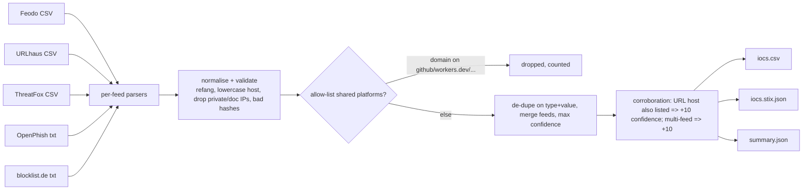

# ioc-aggregator: public threat-intel feeds, normalised, de-duplicated, exported as STIX 2.1

> **Lab project.** It pulls 5 free public feeds (abuse.ch Feodo Tracker, URLhaus and ThreatFox, OpenPhish community, blocklist.de SSH). The raw feed data is **not committed** (`data/raw/` is git-ignored, and SHA-256 hashes of the snapshot I used are in `results/`). Tests use small fixtures in the real feed formats.

## Problem
A small SOC subscribes to several free feeds. Each has a different format. They overlap, they contain junk (private IPs, malformed URLs), and some list shared platforms (`workers.dev`, `github.com`) where blocking the whole domain would break the business. ioc-aggregator turns 5 feeds into **one clean, de-duplicated, confidence-scored list**: CSV for the SIEM lookup table and a **STIX 2.1 bundle** for MISP/OpenCTI.

## Architecture


## Run
```bash
pip install -r requirements-dev.txt
pytest -q                                   # offline fixtures
python -m iocagg.cli --fetch -o results     # live pull of all 5 feeds
python -m iocagg.cli -o results             # re-process the last snapshot in data/raw
docker build -t iocagg . && docker run --rm iocagg
```
CI also runs on a daily cron and uploads the feed as a build artifact. Nothing is published.

## Results (actual live run, 2026-10-11 ~15:46 IST)
| Metric | Value |
|---|---|
| Raw records | 44,618 (URLhaus 32,923, ThreatFox 6,752, blocklist.de 4,638, OpenPhish 300, Feodo 5) |
| Invalid dropped | 6 |
| Allow-listed (shared-platform domains) | 73 |
| Exact duplicates merged | 877 |
| **Unique IOCs** | **43,662** (URLs 33,638, IPv4 7,076, domains 2,268, sha256 532, md5 148) |
| Seen in >1 feed | 12 (e.g. ClickFix / RuneLite-lure URLs in both URLhaus and ThreatFox, an IP in both blocklist.de and ThreatFox) |
| URLs whose host is itself a listed IP/domain | 896 |
| STIX 2.1 Indicators | 43,662 (bundle serialised and validated by `stix2`, 28.5 MB) |
| Runtime | 8.3 s fetch + about 17 s processing/STIX |

`pytest`: 6 passed. Excerpt of multi-feed IOCs: `results/iocs_multi_feed_sample.csv`.

**Observations from the real run**
- **Feodo Tracker is stale.** Its header says last updated 2026-03-04 and it has only 5 rows. A feed health check (max age) should be the next feature.
- Overlap between feeds is tiny (12 of 43k). Free feeds mostly *don't* corroborate each other, so "multi-feed" is a strong but rare signal.
- Python 3.13 classes RFC 5737 documentation IPs as `is_private`, so my first test fixtures were silently dropped. I switched fixtures to real public IOCs and added a regression test. It's the same pitfall I hit in L1-Copilot.

## Limitations
- No ageing/expiry. IOCs from a single snapshot are kept as-is. IP IOCs go stale within days (cloud/CGNAT reuse).
- The allow-list is a short hand-written list. A production build would use Tranco top-N plus internal domains. Some cloud hostnames (e.g. `*.googleusercontent.com`) still pass through.
- The URLhaus `tags` field lands in the `malware` column, which is a loose mapping.
- A single 28 MB STIX bundle is unwieldy. Use `--stix-limit` or TAXII collections in practice.
- Respect each feed's terms of use (abuse.ch feeds are CC0, but OpenPhish community and blocklist.de have their own terms). That's why raw data isn't redistributed.
- The Docker image was not built yet.

## Sources
- abuse.ch Feodo Tracker: https://feodotracker.abuse.ch/blocklist/ ; URLhaus: https://urlhaus.abuse.ch/api/ ; ThreatFox: https://threatfox.abuse.ch/export/
- OpenPhish community feed: https://openphish.com/phishing_feeds.html
- blocklist.de: https://www.blocklist.de/en/export.html
- STIX 2.1 spec (Indicator, patterning): https://docs.oasis-open.org/cti/stix/v2.1/stix-v2.1.html ; python-stix2: https://github.com/oasis-open/cti-python-stix2
- Python `ipaddress` is_private behaviour: https://docs.python.org/3/library/ipaddress.html
